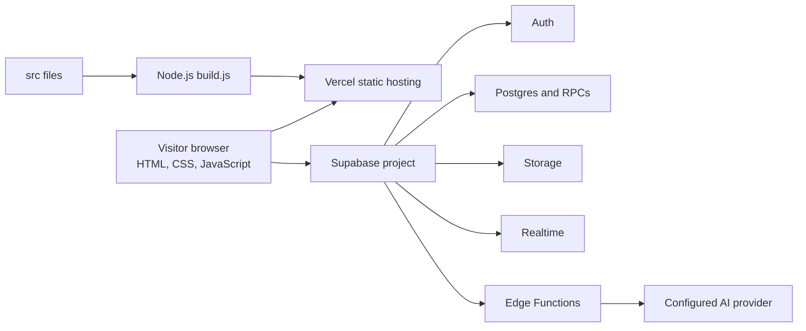

# Dash Lebanon

Dash Lebanon is an online storefront for everyday products in Lebanon. This repository contains the static website source, its build script, two Supabase database updates, and the source for the `ai-chat` Edge Function.

**Live website:** [www.dashlb.shop](https://www.dashlb.shop)

## Screenshots

The original project archive did not include screenshots, so none are shown here yet. Add screenshots to `screenshots/` after checking that they contain no customer names, phone numbers, addresses, order details, or admin data.

## Features visible in the source

- Product catalog with categories, search, sorting, product details, offers, and product options.
- Cart, checkout, order tracking, and order history.
- Customer accounts, password reset, wishlists, loyalty points, coupons, and account data export/deletion screens.
- Admin screens for products, orders, customers, store settings, offers, and support chat.
- AI text assistant backed by the included Supabase `ai-chat` function; the function supports OpenAI-compatible and Anthropic-style provider requests.
- Live voice assistant UI, realtime updates, privacy information, and store policy pages.

These are features represented in the files. Some require a separately configured Supabase project and server functions that are not included in this repository.

## Technology

- HTML, CSS, and browser JavaScript for the storefront.
- TypeScript and Deno for the included Supabase Edge Function.
- Supabase JavaScript client, Supabase Auth, Postgres RPCs, Storage, Realtime, and Edge Functions.
- Node.js built-in modules for `build.js`; the build script has no npm dependencies.
- Vercel configuration for hosting and route rewrites.
- SQL for the included database updates.

The browser bundle includes the Supabase JavaScript client version identified in its source header (`2.118.0`). The Edge Function imports Supabase JS using the major-version range `@2`, so its resolved version can change over time.

## Architecture



The website uses a public Supabase publishable key in the browser. This key is not a password; database access must be protected by correct Row Level Security policies and server-side checks.

## Repository layout

```text
index.html                         Website shell and page metadata
src/css/                           Editable stylesheets
src/js/                            Editable browser scripts, including Supabase client bundle
css/ and js/                       Generated, hashed assets used by static hosting
build.js                           Combines source files and updates asset references
sql/                               Two incremental Supabase SQL updates
supabase/functions/ai-chat/        Included AI chat Edge Function
vercel.json                        Hosting rewrites and response headers
DEPLOY-PHASE13.md                  Existing phase-specific deployment notes
.env.example                       Placeholder names for server-side configuration
```

The generated files in `css/` and `js/` are kept because `index.html` references them and the current deployment notes expect ready-to-serve static files.

## Setup and build

### Requirements

- Node.js for rebuilding the static assets.
- A Supabase project containing the application's existing database schema, policies, RPC functions, storage setup, and any required Edge Functions.
- A Vercel project (or another static host that supports the route rewrites in `vercel.json`).

### Build the website assets

From the repository root, run:

```sh
node build.js
```

This combines `src/css/` and `src/js/`, creates hashed files under `css/` and `js/`, and updates the matching references in `index.html`. It does not install packages or configure Supabase.

### Configure Supabase

The included SQL files are **incremental updates**, not a complete database setup. They expect the application's earlier schema and functions to already exist. Review the SQL and back up the project before applying database changes.

1. Create or use the Supabase project that already contains the application's base schema and policies.
2. Review and apply `sql/04-admin-chat-realtime.sql`, then `sql/05-privacy-self-service.sql`, only after confirming that their assumptions match that database.
3. Configure the included `ai-chat` Edge Function with server-side secrets. The existing deployment notes specify a custom authentication check for this function; review the authentication configuration and function code before deploying it.
4. Keep service-role and AI provider keys in Supabase Edge Function secrets. Never place them in browser JavaScript, a public repository, screenshots, or a public `.env` file.

See [`.env.example`](.env.example) for placeholder variable names referenced by the included function. The static browser build does not load `.env` files.

The browser also calls `gemini-live-token`, `send-order-confirmation`, `cancel-order-otp`, `notify-password-changed`, and `reverse-geocode`. Their implementations are not included here, so the related features need those functions to be configured separately.

### Deploy

The provided archive includes generated assets and the deployment notes say that no build command is needed for a direct static deployment. If you edit files under `src/`, run `node build.js` before deploying. Confirm the Vercel project's root directory and rewrite behavior in its preview before changing production settings.

## Environment variables

The included Edge Function reads `SUPABASE_URL` and either `SERVICE_ROLE_KEY` or `SUPABASE_SERVICE_ROLE_KEY`. It can also read `GROQ_API_KEY`, `AI_MODEL`, `AI_API_URL`, and `AI_PROVIDER`. Values in `.env.example` are placeholders; add actual values only through the provider's server-side secret settings.

The browser code contains the project's Supabase URL and a publishable key. These are public client settings, not server secrets. Do not replace them with a service-role key.

## Security and privacy

- The application handles account details, phone numbers, delivery addresses, orders, support messages, and optional voice input. Do not add real customer records to this repository or use them in public screenshots.
- The Supabase publishable key is visible to visitors by design. Row Level Security, database functions, and server-side authorization must prevent users from reading or changing other customers' data.
- Use server-side secrets for privileged database access and AI provider keys. Avoid storing provider keys in browser-accessible database records where possible.
- Guest order tracking uses an order number and a phone-number check. Review rate limiting and the amount of order data returned before relying on it for production privacy.
- The included Edge Function applies message limits using a client-provided session identifier. That limit can be bypassed by starting new sessions; add server-enforced abuse controls before treating it as a spending limit.
- The submitted archive included a hard-coded store contact and administrator-login email placeholder. This branch removes those fixed values; contact links now use Supabase Store Settings and are hidden when no contact is configured. Confirm any Supabase contact details are approved for public display.
- The original ZIP is still present in the remote `main` branch and an earlier commit. This branch removes it from the proposed current tree, but Git history still retains it; remove the ZIP from the default branch after reviewing this branch. A history rewrite would be required to erase old Git objects, and is not part of this work.
- The existing public commit metadata includes an email address. This branch uses a GitHub no-reply address for its new local commit; the old commit remains unchanged.

This is a source-level review, not a complete security audit. The base database schema, all Row Level Security policies, Supabase project settings, and the implementations of other Edge Functions were not present in the archive.

## Current limitations

- The repository does not contain the initial database schema or the complete set of SQL migrations.
- Several functions called by the browser are not included, including `gemini-live-token`, email-delivery functions, and `reverse-geocode`.
- Checkout is paused in the source when product options are selected until the server-side order function verifies option prices and stock.
- Reverse geocoding is disabled in the browser configuration.
- No project screenshots are included yet.
- The archive does not include the `assets/` files referenced by the page metadata, such as the social preview image and touch icon.
- The live site was viewed, but end-to-end shopping, account, and admin flows were not tested.

## Roadmap

- Add the complete, reviewed database setup and migrations.
- Include or document the remaining Edge Functions and their server-side configuration.
- Add server-side rate limits for AI chat and guest order lookup.
- Complete server-side validation for product options before enabling option-based checkout.
- Add safe, current screenshots and a documented preview workflow.
- Pin the Edge Function's Supabase client dependency to an exact version.

## Developer

Created by Ali Salou, a Lebanese student interested in technology, web development, AI, business, and entrepreneurship. This README does not include personal contact details or age.

## Acknowledgements and AI tools

The project uses Supabase, Vercel, and the Supabase JavaScript client. The source archive does not identify which AI tools were used while building the project; add credits here if applicable. The AI shopping assistant is a project feature and is separate from any tools used to write this documentation.

## License

No open-source license is included. Choose a license only after confirming that you have permission to publish and license the code. Until then, assume the code remains all rights reserved.
