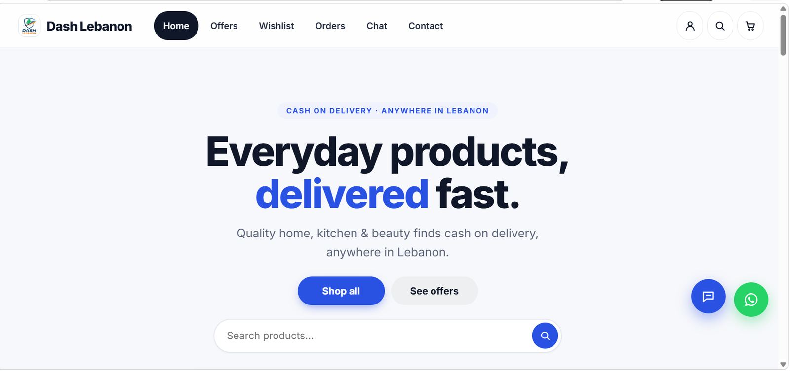
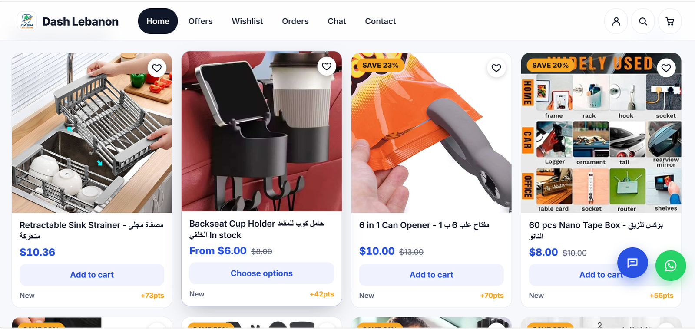
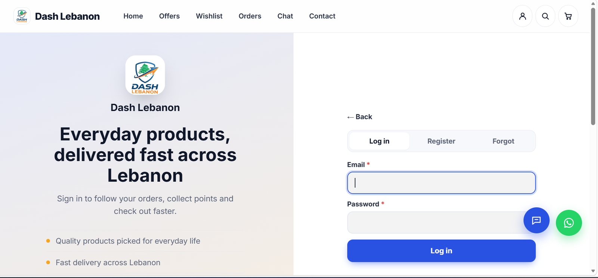
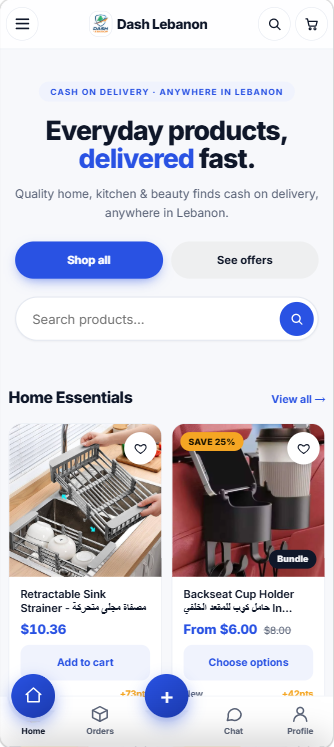
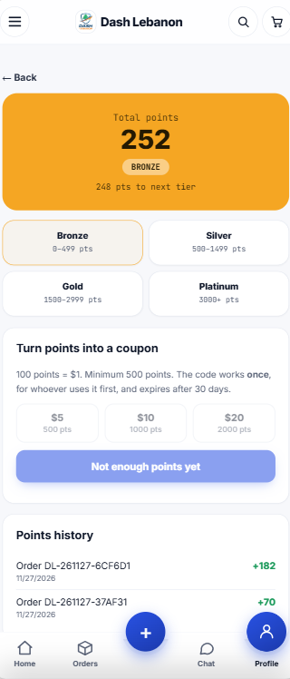
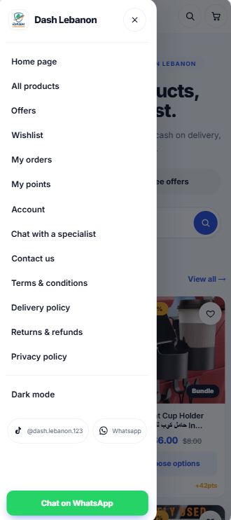
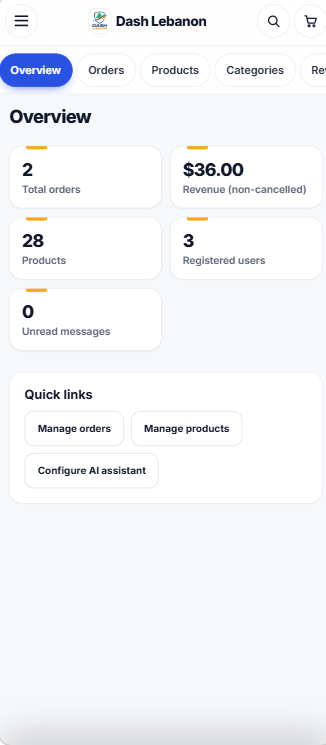
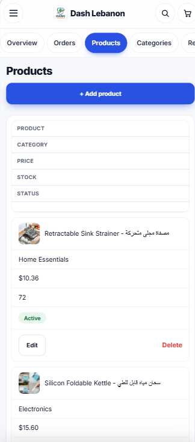

# Dash Lebanon – Screenshots

A quick visual tour of the Dash Lebanon web app: a cash-on-delivery ordering site for everyday home, kitchen and beauty products across Lebanon.

## Desktop

### Home
Hero section with the main call-to-action buttons, product search, and quick access to the chat and WhatsApp buttons.

### Products
Product grid with discount badges, wishlist hearts, prices, loyalty points per product, and either "Add to cart" or "Choose options" for products with variants.

### Login / Register
Sign in, register, or reset a password to track orders, collect points and check out faster.

## Mobile

<table>
  <tr>
    <td align="center" width="25%"><b>Home</b></td>
    <td align="center" width="25%"><b>Points &amp; rewards</b></td>
    <td align="center" width="25%"><b>Side menu</b></td>
  </tr>
  <tr>
    <td></td>
    <td></td>
    <td></td>
  </tr>
</table>

- **Home:** mobile-first layout with a bottom navigation bar and a center "+" quick-action button.
- **Points & rewards:** loyalty tiers (Bronze, Silver, Gold, Platinum), points history, and converting points into a one-time coupon.
- **Side menu:** all main pages plus policies (terms, delivery, returns, privacy), dark mode, and social links.

## Admin dashboard (mobile)

<table>
  <tr>
    <td align="center" width="33%"><b>Overview</b></td>
    <td align="center" width="33%"><b>Products</b></td>
  </tr>
  <tr>
    <td></td>
    <td></td>
  </tr>
</table>

- **Overview:** orders, revenue, products, registered users and unread messages at a glance, with quick links to manage orders, products and the AI assistant.
- **Products:** add, edit and delete products, with category, price, stock and status.
